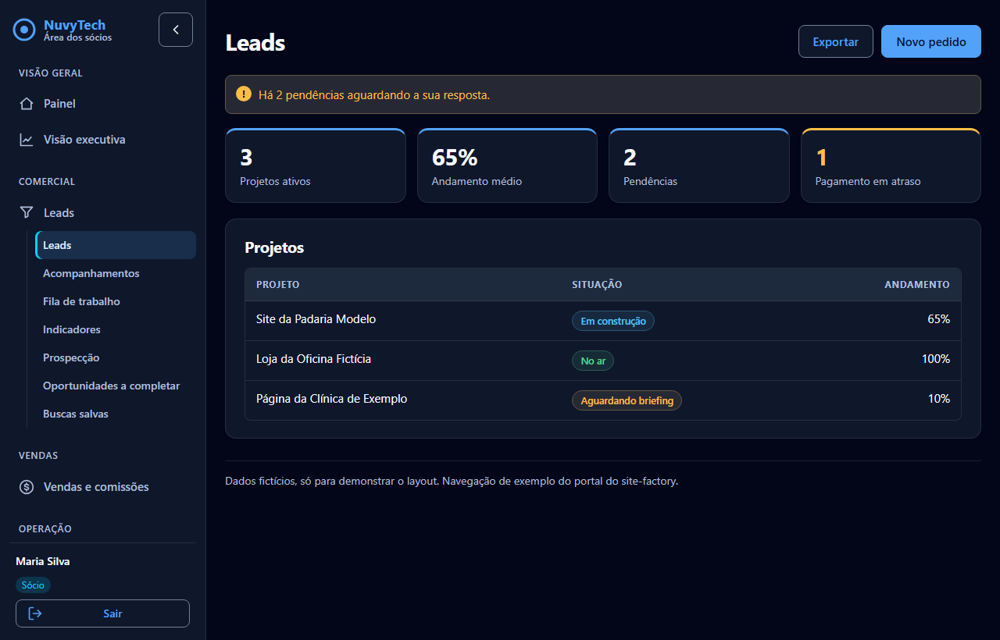
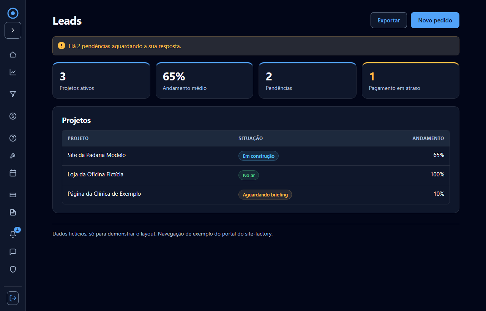
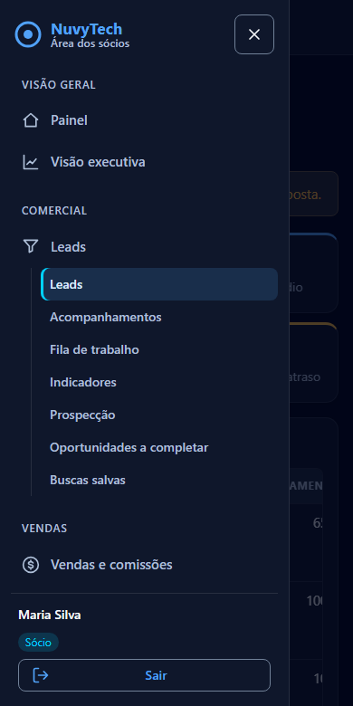
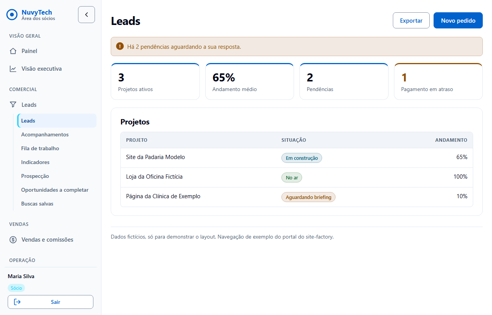
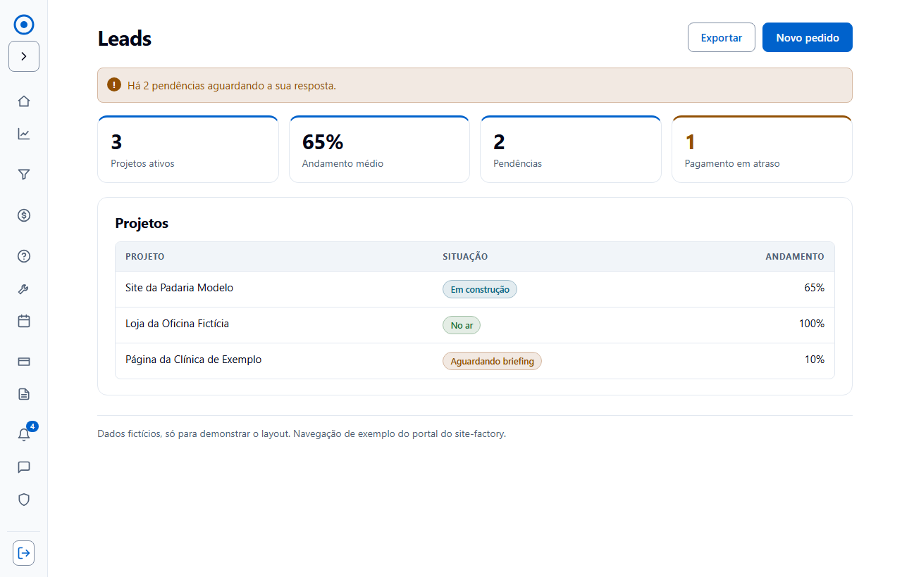
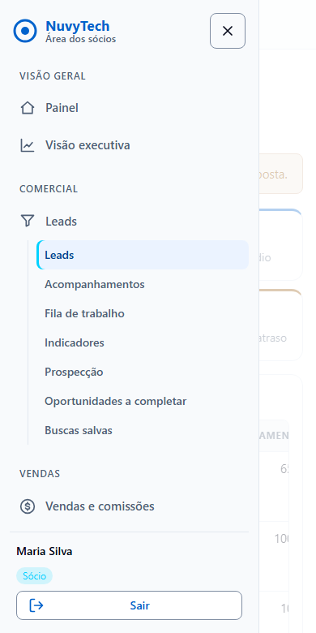

# Layout com coluna lateral

Variante do layout padrão `nv-` em que a navegação sai do topo e vira uma coluna à esquerda. **O cabeçalho no topo continua sendo o padrão**; a coluna só vale quando o `<body>` leva `nv-pagina--lateral`. Primeiro uso previsto: o portal do site-factory (HTML gerado no servidor, sem Angular).

Ver: `previa/layout-lateral.html` (papéis e modos pela URL), `modelos/layout-lateral-exemplo.html` (HTML estático para copiar) e `modelos/nuvy-lateral.js` (JavaScript opcional, sem dependências).

| Desktop | Recolhida | Celular (gaveta aberta) |
|---|---|---|
|  |  |  |
|  |  |  |

Celular com a gaveta fechada: [escuro](img/lateral-celular-escuro.png), [claro](img/lateral-celular-claro.png).

## Classes

| Peça | Classe |
|---|---|
| `<body>` | `nv-pagina nv-pagina--lateral` |
| Estrutura | `nv-app` (envolve tudo), `nv-lateral` (a coluna, um `<aside id="nv-lateral">`), `nv-lateral-corpo` (a coluna do conteúdo), `nv-lateral__fundo` (véu atrás da gaveta, com `data-nv-fechar`) |
| Topo da coluna | `nv-lateral__topo` com `nv-marca` e os botões `nv-lateral__botao--recolher` (`data-nv-recolher`) e `--fechar` (`data-nv-fechar`) |
| Links | `nv-lateral__nav` (`<nav>`), `nv-lateral__grupo` (título do grupo), `nv-lateral__lista` (`<ul>`), `nv-lateral__link` (`aria-current="page"` marca o atual), `nv-lateral__icone`, `nv-lateral__texto`, `nv-lateral__contagem` (não lidos) |
| Sub-itens | `nv-lateral__sub` (um `<ul>` dentro do `<li>` do item pai) |
| Conta | `nv-lateral__conta` com `nv-conta__nome`, `nv-conta__papel` e o formulário de Sair |
| Celular | `nv-barra-topo` com o botão `data-nv-abrir`, que só aparece com o JavaScript |

## Comportamento

- **Sem JavaScript:** a coluna aparece inteira, no alto da página no celular (sem gaveta). O portal funciona, só fica mais longo.
- **Com `nuvy-lateral.js`** (põe a classe `nv-js` no `<html>`):
  - **Desktop:** botão recolhe a coluna para só ícones (68 px); a escolha fica em `localStorage` (`nuvy-lateral`) e, bloqueado, volta ao expandido. Recolhida, os textos saem da tela mas seguem para leitor de tela, o nome vira dica (`title`) e os sub-itens somem; clicar no item pai abre a página principal dele.
  - **Celular (até 720 px):** a coluna vira gaveta aberta pelo botão de menu na barra do topo. O foco vai para o botão Fechar; Esc ou o véu fecham e devolvem o foco ao botão de menu. Fechada, a gaveta fica com `visibility: hidden` (não entra no Tab).
- **Cores:** só `--sidebar`, `--sidebar-border`, `--sidebar-accent`, `--accent`/`--accent-foreground`, `--muted-foreground`, `--primary` e `--marca-2`. Os pares de contraste usados (sidebar-foreground/sidebar, muted-foreground/sidebar, accent-foreground/accent) já são conferidos por `npm test` no claro e no escuro. Foco: o mesmo anel de 4 px (`--nv-foco`) do resto do layout. Movimento respeita `prefers-reduced-motion`.
- **Ícones:** cada item de primeiro nível precisa de um ícone (SVG de 20 px, `aria-hidden`), senão recolhida não tem o que mostrar. Sub-itens não levam ícone.

## Como a navegação do portal vira coluna

Fonte (só leitura): `apps/operational-bot/src/portal/views.ts` do site-factory. Hoje há três níveis: menu principal por papel (`navItems`), submenus (`commercialItems`, `salesItems`) e abas (`routedTabs`). Proposta:

| Hoje | Na coluna |
|---|---|
| Menu principal (`nav.main`) | **grupos** com título (`nv-lateral__grupo`) e um `nv-lateral__link` por item |
| Item atual (`activeHref`: prefixo mais longo) | `aria-current="page"` no link; se tem sub-itens, o pai fica expandido e o sub-item atual leva o `aria-current` |
| Submenu do Comercial e de Vendas (`commercialItems`, `salesItems`) | **sub-itens** (`nv-lateral__sub`) sob o pai, expandidos só quando o pai é o atual |
| Abas `routedTabs` | sub-itens do item da página, ou ficam como abas no conteúdo quando são filtros da mesma tela (decidir por tela) |
| Contagem de não lidos (`.count`) | `nv-lateral__contagem` com `aria-label="N não lidos"` |
| `.account` (nome, papel, Sair com CSRF) | `nv-lateral__conta`, no pé; o `<form method="post" action="/sair">` e o token CSRF não mudam |
| `
` do celular | botão de menu + gaveta (com JS); sem JS, a coluna inteira no alto da página |
| `areaLabels` (Portal do cliente / Área dos sócios / Área de vendas) | `nv-marca__sub` |

A coluna vale para todos os papéis; cada um recebe só os próprios itens (a regra do `navItems` não muda). Grupos propostos:

**Cliente**
- *Meu projeto*: Meus projetos, Briefings, Pendências
- *Acompanhamento*: Avisos (contagem), Mensagens, Suporte, Manutenção
- *Financeiro*: Pagamentos, Meus meses grátis
- *Conta*: Segurança, Meus dados (só com o autoatendimento de privacidade), Sobre a NuvyTech

**Vendedor** (só com assurance full)
- *Vendas*: Minha carteira, Tarefas, Indicadores, Relatórios
- *Comunicação*: Avisos (contagem), Mensagens
- *Ajuda e conta*: Como funciona, Segurança

**Sócio** (só com assurance full)
- *Visão geral*: Painel (ativo também em clientes, projetos e usuários, como hoje), Visão executiva
- *Comercial*: Leads, com os sub-itens Leads, Acompanhamentos, Fila de trabalho, Indicadores, Prospecção, Oportunidades a completar e Buscas salvas
- *Vendas*: Vendas e comissões, com os sub-itens Vendas, Vendedores, Pagamentos e bônus, Fila de empresas, Trilha do vendedor e Tarefas por vendedor
- *Operação*: Suporte, Manutenção, Calendário
- *Financeiro*: Financeiro, Relatórios
- *Comunicação e conta*: Avisos (contagem), Mensagens, Segurança

Pontos a decidir na implementação (não bloqueiam este PR):
1. Os agrupamentos acima são sugestão de organização; os nomes e a ordem dos itens vêm do `navItems` e não mudam.
2. Ícones: o portal não tem. Sugestão: um conjunto de SVGs inline de 20 px, um por item (a prévia usa traços simples).
3. As telas de autenticação (`auth`) não têm navegação e ficam como estão (`nv-pagina--estreita`, sem coluna).
4. Com a coluna recolhida os sub-itens não aparecem; se isso incomodar, a alternativa é abri-los num painel ao passar o mouse (mais CSS e JS).
